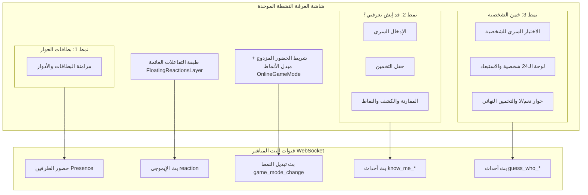

# البنية الهندسية للمرحلة الثالثة: منظومة الألعاب المتعددة في الغرفة المشتركة (Multiplayer Suite Architecture)

## 1. الهيكل العام للتزامن متعدد الأنماط

## 2. بروتوكول البث الفوري عبر WebSocket (Realtime Broadcast Protocol)

جميع أحداث الألعاب تعمل عبر `channel.sendBroadcastMessage` و `channel.onBroadcast` دون الحاجة لكتابة أحداث عابرة في قاعدة بيانات PostgreSQL:

| الحدث (`event`) | المعاملات (`payload`) | الوصف |
|---|---|---|
| `game_mode_change` | `{ mode: 'cards' \| 'knowMe' \| 'guessWho' }` | تبديل اللعبة الحالية في الغرفة لكلا الشريكين |
| `reaction` | `{ emoji, sender_role, timestamp }` | الإيموجي العائم المشترك |
| `know_me_step` | `{ step: 0 \| 1 \| 2, question_id, answering_role, secret_preview?, guess?, match? }` | مزامنة خطوات لعبة قد إيش تعرفني |
| `guess_who_action` | `{ action: 'pick_ready' \| 'ask' \| 'answer' \| 'guess' \| 'restart', role, data }` | مزامنة أدوار وأسئلة واستبعاد خمن الشخصية |

## 3. معايير الأمان والخصوصية (Privacy & Zero-Cheating)
- **في «خمن الشخصية»:** معرف الشخصية السرية لا يُرسل عبر الشبكة حتى لحظة التخمين النهائي أو إعلان الفوز.
- **في «قد إيش تعرفني؟»:** إشعار اكتمال الإجابة السرية يُرسل أولاً، ثم تُكشف الإجابتان معاً عند إرسال التخمين.
- **الصمود بدون اتصال:** في حال فقدان الاتصال، تحتفظ الواجهات بالحالة المحلية وتعرض مؤشر إعادة الاتصال المباشر.
